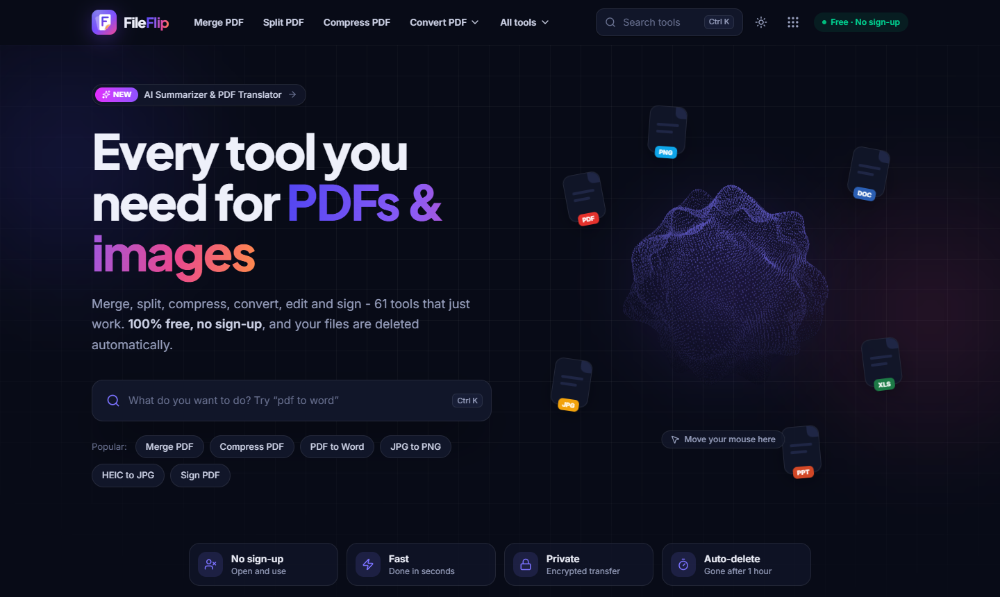
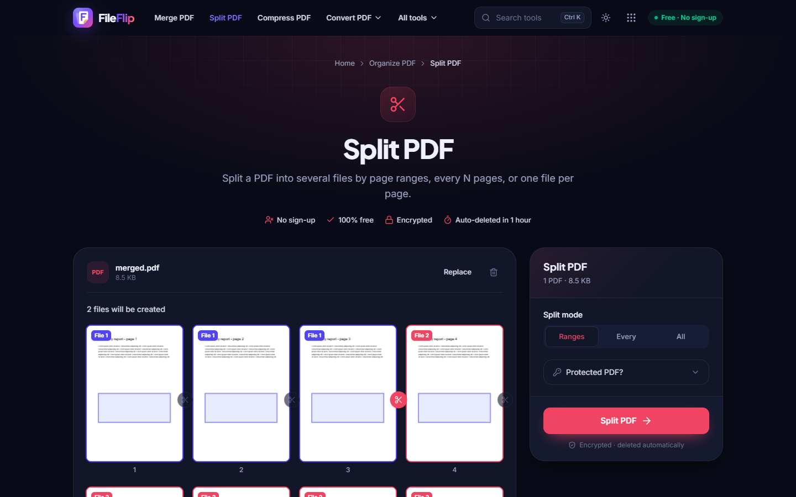
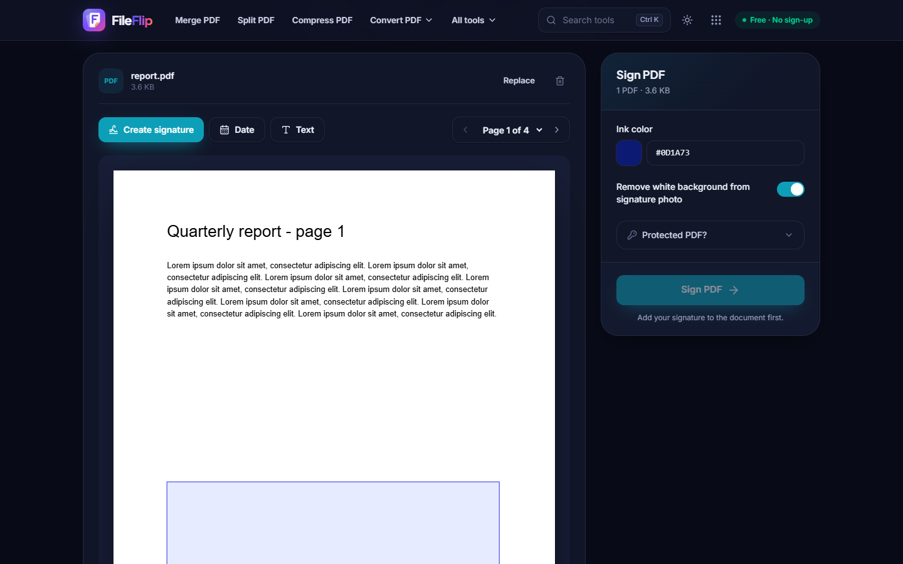
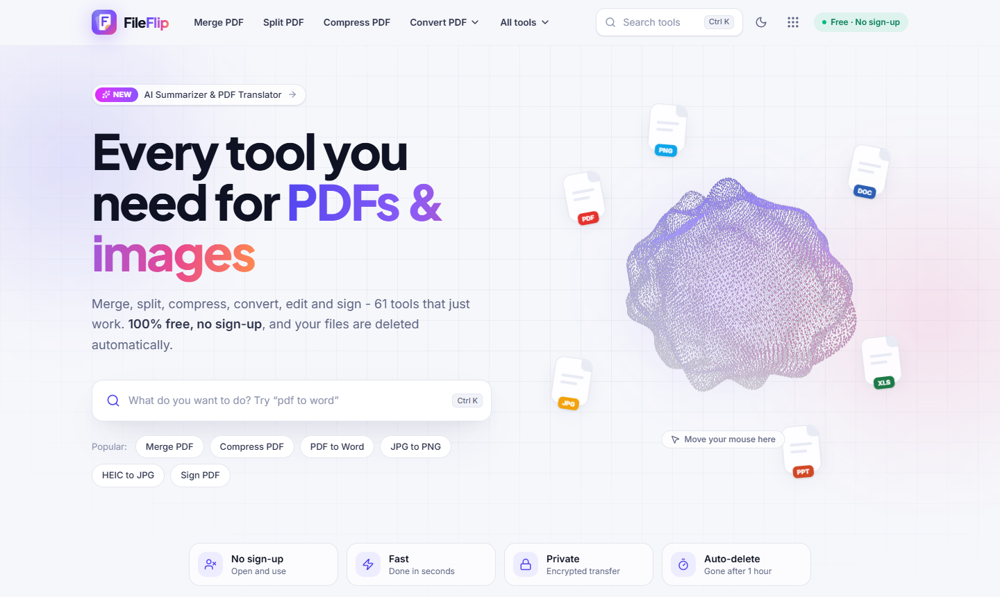

<div align="center">


# FileFlip

### Flip any file. Free. 🔄

**61 free PDF & image tools. No sign-up, no watermarks, no "upgrade to Pro" pop-ups.**
Merge, split, compress, convert, edit and sign — then your files politely self-destruct. 💣

[](https://fileflip-gules.vercel.app)
[](https://nextjs.org)
[](https://fastapi.tiangolo.com)
[](LICENSE)



</div>

---

## 🤔 Why does this exist?

Because somewhere out there, someone just needed to merge **two** PDFs and got asked for their email, phone number, credit card and blood type. 🩸

FileFlip is the opposite of that:

- 🆓 **Actually free.** Not "free trial". Not "free for 3 files a day". Free.
- 🙅 **Zero sign-up.** Open the page, drop a file, done. We don't even know your name.
- 🔒 **Private.** Files travel over HTTPS and are deleted automatically after an hour.
- ⚡ **Fast.** Page previews render right in your browser; most jobs finish in seconds.
- 📱 **Works everywhere.** Phone, laptop, your cousin's ancient tablet. Installable as an app too.
- 🌙 **Dark mode.** Obviously. We're not monsters.

---

## 🧰 What's in the toolbox

| | Category | Tools |
|---|---|---|
| 🗂️ | **Organize PDF** | Merge · Split · Remove pages · Extract pages · Organize (drag & drop) · Scan to PDF |
| 🪶 | **Optimize PDF** | Compress · Repair · OCR (English, Urdu, Arabic, Hindi) |
| 📥 | **Convert to PDF** | JPG · Word · Excel · PowerPoint · HTML → PDF |
| 📤 | **Convert from PDF** | PDF → Word · Excel · PowerPoint · JPG · PNG · Text · PDF/A |
| ✏️ | **Edit PDF** | Full editor (text, shapes, highlight, draw, images) · Rotate · Page numbers · Watermark · Crop · Fill forms |
| 🛡️ | **PDF Security** | Protect · Unlock · Sign (draw / type / upload) · Redact · Compare |
| 🧠 | **PDF Intelligence** | AI Summarizer · AI Translator · PDF → Markdown |
| 🖼️ | **Image Tools** | 26 tools: JPG ⇄ PNG ⇄ WEBP, HEIC (iPhone photos!), GIF, BMP, TIFF, SVG, ICO, resize & compress |

> 💡 **Pro move:** every result has a **"Continue with…"** button. Convert a photo to PNG, then straight into a PDF, then compress it — without uploading again.

---

## 📸 Sneak peek

<table>
  <tr>
    <td></td>
    <td></td>
  </tr>
  <tr>
    <td align="center">✂️ <b>Split visually</b> — click the scissors between pages</td>
    <td align="center">✍️ <b>Sign anything</b> — draw, type or upload a signature</td>
  </tr>
  <tr>
    <td colspan="2"></td>
  </tr>
  <tr>
    <td colspan="2" align="center">☀️ Light mode, for the brave</td>
  </tr>
</table>

---

## 🏗️ How it's built

```
FileFlip
├── frontend/   ⚛️  Next.js 15 · React 19 · Tailwind 4 · TypeScript · pdf.js · WebGL particle hero
└── backend/    🐍  FastAPI · PyMuPDF · pdf2docx · Pillow · LibreOffice · Ghostscript · Tesseract
```

- **Frontend** — 137 pre-rendered, SEO-friendly pages (one per tool), visual editors, Ctrl + K search, a 9-dot apps menu, social share cards for every tool, and a PWA you can install.
- **Backend** — every tool is one decorated Python function in a registry. Uploads stream to disk, get checked by their magic bytes (not just the file extension 🕵️), run in a temp job folder and are swept away after an hour. Rate-limited per IP so nobody hogs the blender.

---

## 🚀 Run it on your machine

You'll need **Node 20+** and **Python 3.11+**. The optional engines unlock extra tools:

| Engine | Unlocks | Windows | macOS / Linux |
|---|---|---|---|
| 📄 LibreOffice | Word / Excel / PowerPoint → PDF | `winget install TheDocumentFoundation.LibreOffice` | `brew install --cask libreoffice` / `apt install libreoffice` |
| 👻 Ghostscript | PDF/A, deep repair | [installer](https://ghostscript.com/releases/gsdnld.html) | `brew install ghostscript` / `apt install ghostscript` |
| 👀 Tesseract | OCR | `winget install UB-Mannheim.TesseractOCR` | `brew install tesseract` / `apt install tesseract-ocr` |
| 🤖 Anthropic API key | AI Summarizer & Translator | `ANTHROPIC_API_KEY` in `backend/.env` | same |

Everything else works without them. Missing engines just switch their tools off politely. 🙇

**1. Backend** 🐍

```bash
cd backend
python -m venv .venv
.venv\Scripts\activate          # macOS/Linux: source .venv/bin/activate
pip install -r requirements.txt
uvicorn app.main:app --reload --port 8000
```

API docs live at http://localhost:8000/docs.

**2. Frontend** ⚛️

```bash
cd frontend
npm install
cp .env.example .env.local      # points at http://localhost:8000 by default
npm run dev
```

Open http://localhost:3000 and start flipping. 🎉

**3. Tests** 🧪

```bash
cd backend && pytest            # 47 tests, no flaky drama
```

---

## ☁️ Deploying

| Part | Where | How |
|---|---|---|
| 🌐 Frontend | **Vercel** | Import the repo, set **Root Directory** to `frontend`, add `NEXT_PUBLIC_API_URL` (your backend URL) and `NEXT_PUBLIC_SITE_URL` (your site URL). |
| ⚙️ Backend | Any **Docker** host (Render, Railway, Fly.io, Hugging Face Spaces, a VPS…) | `backend/Dockerfile` already bundles LibreOffice, Ghostscript and Tesseract with Urdu / Arabic / Hindi. Set `CONVERTOR_CORS_ORIGINS=["https://your-site"]`. |

> 🧐 *Why not run the backend on Vercel too?* Serverless functions can't carry a 500 MB office suite around, and they cap uploads at a few MB. A tiny Docker box is the right home for it.

---

## 🙋 FAQ

**Is it really free?**
Yes. There is no premium tier. There is no secret premium tier. We checked twice. ✅

**Where do my files go?**
To a temporary folder on the server, then into the void after 60 minutes — or instantly if you press **Delete now**. 🕳️

**Can it convert my 1998 WordPerfect file?**
…honestly? Probably. LibreOffice has seen things. 👴

**Why does my PDF have 400 pages?**
That one's on you, friend. 📚

---

## 🤝 Contributing

Found a bug? Want a new tool? PRs and issues are very welcome. Adding a tool is usually one Python function with a `@tool(...)` decorator, then `npm run sync-tools` in `frontend/`, and every page, menu and sitemap entry updates itself. ✨

---

## 📜 License

[GNU AGPL v3](LICENSE). FileFlip is built on PyMuPDF, which is AGPL, so the source stays open for everyone, just like the tools. 💜

---

<div align="center">

### 🍪 Designed & built by [Muhammad Talha Khan](https://muhammadtalhakhan2003.github.io/PortFolio_Talha/)

*Powered by Cookies & Brookies.* 🍪

If FileFlip saved you from a sign-up form today, drop a ⭐. It costs nothing, which is a theme around here.

</div>
